<p align="center">
  
</p>

<h1 align="center">Chipova Forge</h1>

<p align="center">
  <b>From a finished chip to a working product.</b><br>
  Put your chip on a board, give it firmware and watch it run in your browser: the firmware on a virtual MCU,
  your chip's own RTL beside it, the physics around it. Then the app, the tests, the PCB, and a release someone else signs.
  With your whole team at once, and with AI that asks before it changes anything.
</p>

<p align="center">
  <a href="#install-it-from-the-agentic-app-store"><b>Install it</b></a> ·
  <a href="#what-you-get">What you get</a> ·
  <a href="#people-and-ai-together">People and AI</a> ·
  <a href="#the-twelve-steps">The twelve steps</a> ·
  <a href="#run-it-from-source">Run from source</a>
</p>

<p align="center">
  <a href="LICENSE"></a>
  
  
  
  <a href="https://milochen0418.github.io/re_ddns/"></a>
</p>

<p align="center">
  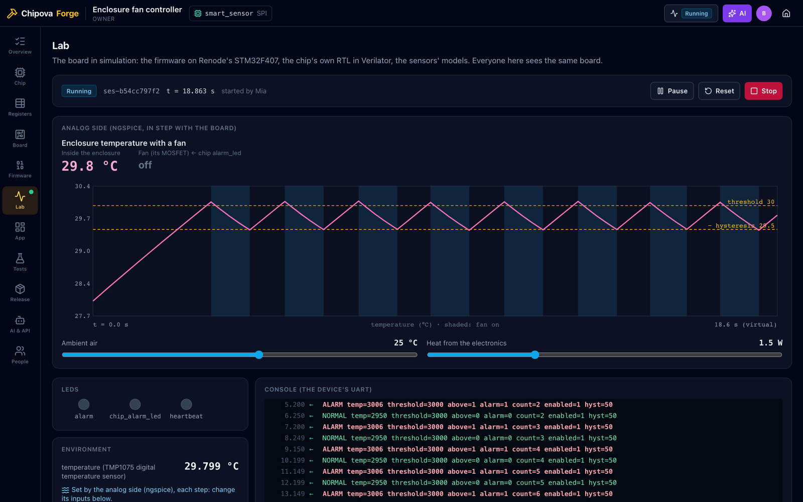
</p>

A chip on its own does nothing. Between a finished design and a thing people can use stand a board, firmware, an
app, tests, a PCB and the evidence that it all works, and usually a different tool, file format and person for each.
**Chipova Forge puts that whole road in one place.** Bring a chip from [Chipova](https://github.com/milochen0418/chipova),
and Forge builds everything around it, step by step, with the open-source engines the industry already trusts.

The picture above is real: an STM32F4's firmware reads a temperature sensor and writes it into the chip over SPI; the
chip's own Verilog compares it with a threshold and switches a fan; ngspice works out how hot the enclosure gets; the
sensor reads that back. Firmware, chip and physics, in one loop, in a browser tab.

## Why Forge

- **Your chip's real RTL, not a stand-in.** Verilator runs the chip's own Verilog beside the firmware, which runs on
  Renode's STM32F407. They talk over SPI at pin level, clock edge by clock edge, as they would on a board.
- **Physics in the loop.** ngspice solves the board's analog side in step with the board, every 50 ms of virtual
  time: the chip's pins drive the circuit, the circuit drives the sensors.
- **A board you can order.** Forge lays out a carrier module for your chip, Freerouting routes it, and KiCad checks it:
  ERC, DRC, and the board against the schematic. Gerbers, drill files, BOM and positions come out at the end.
- **One protocol, three ways in.** The same device commands drive the product's dashboard, the REST API, the Python
  SDK, and a real board over its serial port.
- **Proof, not promises.** System tests run in fresh simulations, a release is checked item by item, and its package
  lists every file with its SHA-256. Someone other than its maker approves it.
- **Everyone on the same board.** Open a product's link and you're in it with your team: the same LEDs, console,
  registers and chart, live, for everyone.
- **AI that asks first.** Through the AI Hub, an AI reads, builds, simulates, tests and packages with 22 tools. It
  never edits a file: it proposes, you see the diff, you decide.
- **Yours.** It runs on your own machine from the Agentic App Store. Every build and simulation runs in a sealed
  container with no network. MIT licensed.

## What you get

### The whole road on one page

Twelve steps, from importing the chip to the release, each with where it stands. Click one to go there.

<p align="center">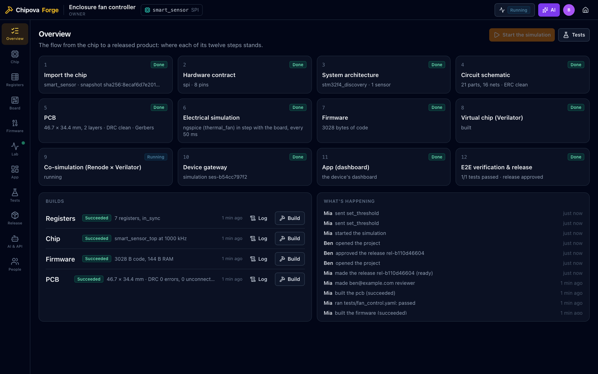</p>

### Start from your chip

Pick a product template and a chip: an example, a Chipova release package, or a chip a teammate published to the
platform's `chips` collection. Forge checks every file against the chip's snapshot id, then reads its hardware contract
straight from the RTL: the interface, clock, reset, interrupts and package pins.

<table>
  <tr>
    <td>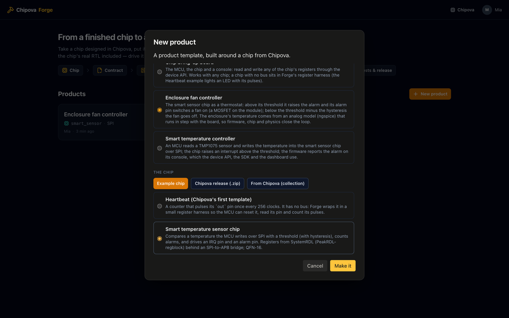</td>
    <td>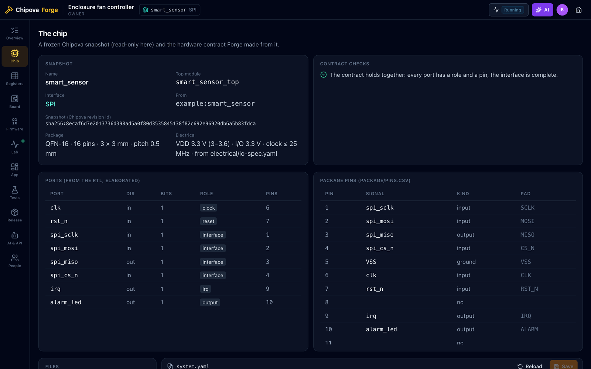</td>
  </tr>
</table>

### Registers from one description

One SystemRDL file makes the chip's register block, the firmware's C header and the SDK's Python map (PeakRDL). Forge
checks that the chip's own register RTL is exactly what the description generates.

<p align="center">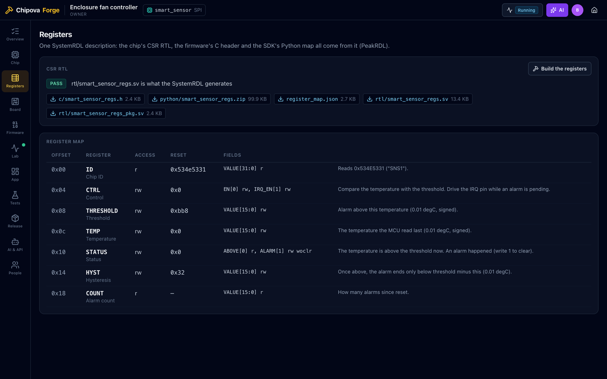</p>

### Run the product before it exists

The Lab starts the whole board in a few seconds: LEDs, the console, a probe that reads the chip's registers over its
own SPI, and the chip's signals as a waveform whenever you ask.

<p align="center">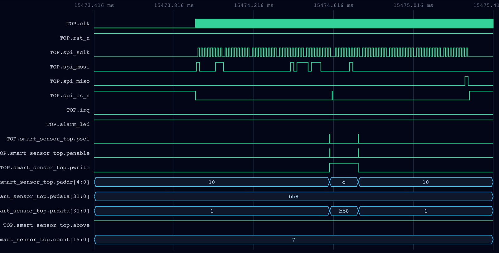</p>

### Physics in the loop

A board can have an analog side: a SPICE circuit ngspice solves in lock-step with Renode. In the fan controller the
electronics heat the enclosure, its case loses heat to the air, and the fan, switched by the chip, cools it. Change the
air or the load with a slider and watch the loop answer.

<p align="center">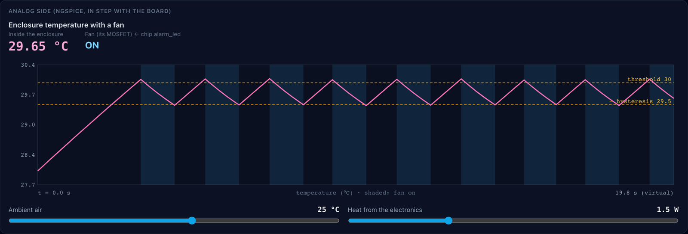</p>

### A board you can order

From the same `system.yaml`: the module's schematic, its two-layer PCB, routed, with ground pours stitched together,
and KiCad's verdict. The example modules come out with 0 ERC errors, 0 DRC errors, nothing unconnected and no
difference between board and schematic.

<table>
  <tr>
    <td>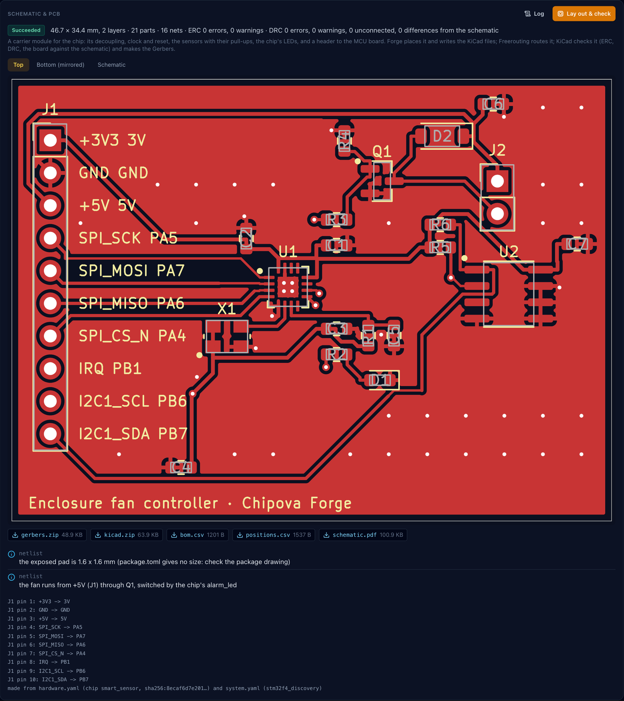</td>
    <td>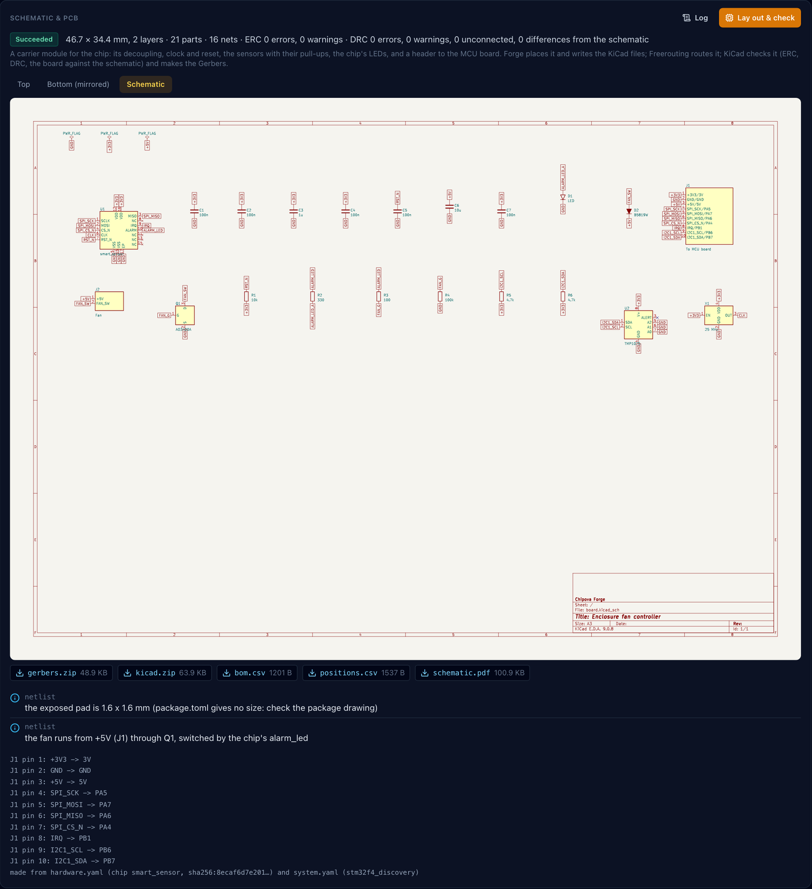</td>
  </tr>
</table>

### An app, an API and an SDK from one protocol

`device.yaml` says what the device understands: one line out, one line back. The dashboard is built on it, the REST API
serves it, and the SDK speaks it, to the virtual board or to a real one over USB:

```python
from chipova_forge_sdk import Device
device = Device("ses-…", url="https://chipova-forge.reflex-ddns.com", token="cfg1.…")
print(device.get_status().temperature)
device.set_threshold(celsius=35)
device.environment("analog", load=0)                                   # the virtual board only
real = Device.serial("/dev/cu.usbmodem1101", profile="device.yaml")   # the same calls, a real board
```

<p align="center">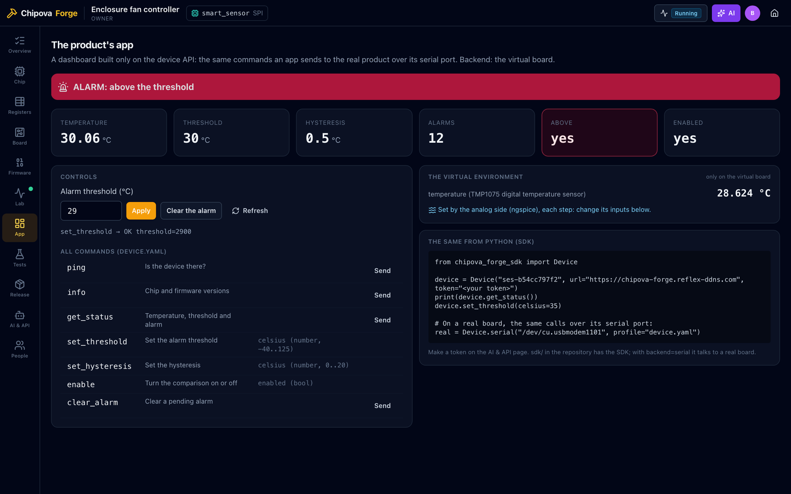</p>

### Tests and a release you can trust

A test drives the board's world and checks the device's answers, events, LEDs, registers and analog values, each step
in a fresh simulation. The release page checks everything at once; the package holds the sources, the builds, the PCB
outputs and each test's evidence, and a reviewer approves it.

<table>
  <tr>
    <td>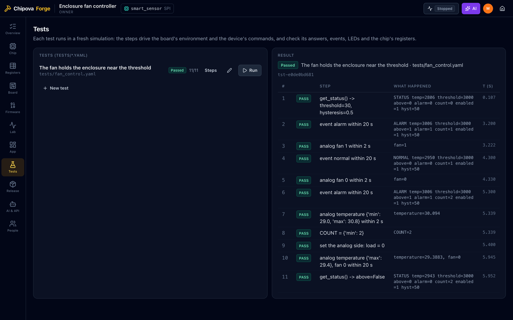</td>
    <td>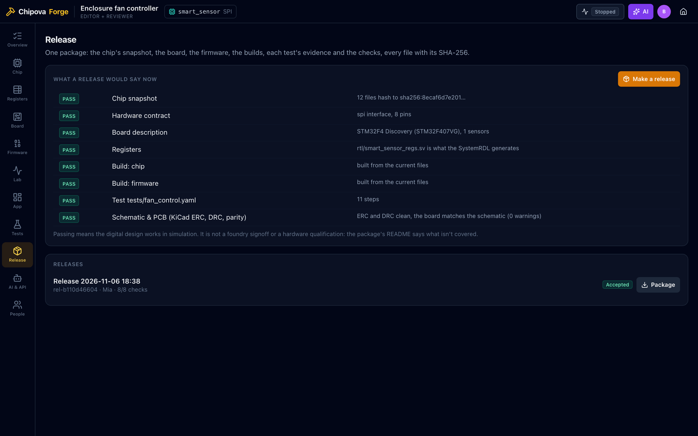</td>
  </tr>
</table>

## People and AI together

Everyone who opens a product works on the same one: the same running board, the same builds, tests and releases,
updated on every screen as they happen. Owners decide who may see, edit and approve (People page).

The AI Hub's assistant opens on the product you're in, and its `forge.*` tools let an AI do the work a teammate would:
read the chip and its registers, build, start the board, change its environment, read registers and waveforms, run
tests, make a release package. What it may not do is just as clear. It never edits a file: it proposes, and you see
exactly what would change before you accept or reject it (with a reason it reads). It never approves a release. And
everything it does, refusals included, is in the audit log.

<table>
  <tr>
    <td>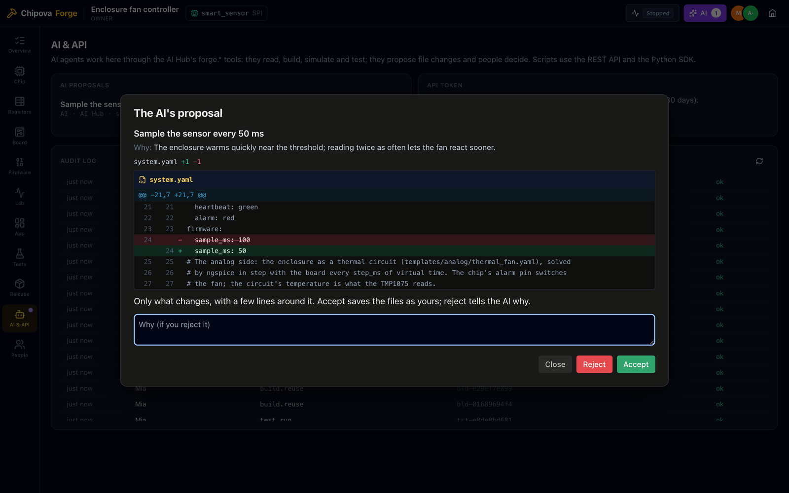</td>
    <td>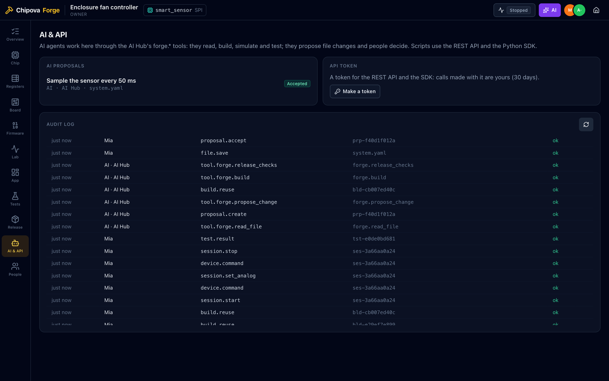</td>
  </tr>
</table>

## Install it from the Agentic App Store

The quickest way to run Forge is the [Agentic App Store](https://milochen0418.github.io/re_ddns/): an open-source
store that runs on your own computer, installs apps with one click and gives each one its own HTTPS address.

1. Get the store. It needs Docker on a Mac or Linux host; [one script](https://github.com/milochen0418/re_ddns#quick-start-run-from-zero) sets it up.
2. Open `https://aapps.reflex-ddns.com`, find **Chipova Forge** and press **Install**.
3. Open `https://chipova-forge.reflex-ddns.com`. The first time, press **Install** under *Install Forge's tools
   first*: Forge builds its two tool images on your machine (Renode, Verilator, Arm GCC and ngspice; KiCad and
   Freerouting), a few minutes with the store's download cache.
4. Press **New product**, pick the enclosure fan controller, and start the simulation.

## The twelve steps

| # | Step | What Forge does | Engine |
|---|------|-----------------|--------|
| 1 | Import the chip | Takes a Chipova release (a `.zip`, an item of the platform's `chips` collection, or an example) and checks every file against its snapshot id | — |
| 2 | Hardware contract | Elaborates the RTL's ports and finds the interface (SPI, APB3 or none), clock, reset, interrupts, package pins and electrical limits: `hardware.yaml` | pyslang |
| 3 | System architecture | `system.yaml`: the MCU platform, which pins reach the chip, the sensors, the console, the LEDs, the analog side; checked for clashes | — |
| 4 | Circuit schematic | The carrier module's parts and nets, a KiCad schematic, ERC | KiCad |
| 5 | PCB | Placement on the module template, routing, ground pours and stitching, DRC with schematic parity, Gerbers, drill, BOM, positions | Freerouting, KiCad |
| 6 | Electrical simulation | An analog model (a SPICE circuit) solved in lock-step with the board, driving its sensors and driven by the chip's pins | ngspice |
| 7 | Firmware | Bare-metal C on the platform's start-up code, Forge's chip driver (SPI frames or the external bus), `board.h` and the register header | Arm GCC |
| 8 | Virtual chip | The chip's RTL as a co-simulation library (a register harness for chips with no bus) | Verilator |
| 9 | Co-simulation | The firmware on Renode's STM32F407 with the chip's RTL on SPI (pin level) or the external bus; sensors, LEDs, UART | Renode × Verilator |
| 10 | Device gateway | One protocol (`device.yaml`) for the simulated board and a real one: REST API, events, the Python SDK | — |
| 11 | The product's app | A dashboard built only on the device API | Reflex |
| 12 | Verification & release | System tests (`tests/*.yaml`) in fresh simulations; release checks; a package with every file's SHA-256, approved by someone else | — |

Three products to start from: the **enclosure fan controller** (the smart sensor chip as a thermostat, with its analog
side), the **smart temperature controller** (the same chip as an alarm), and the **chip bring-up board** (any chip's
registers from a console; a chip with no bus, like the Heartbeat example, sits in Forge's register harness).

## Run it from source

Python 3.11 with Poetry (the venv is in-project), Docker, and Forge's two images (build them by hand as below,
or press **Install** on Forge's home page):

```bash
poetry env use python3.11 && poetry install
docker build -t chipova-forge/sim:1   infra/dockerfiles/forge-sim     # Renode, Verilator, Arm GCC, ngspice
docker build -t chipova-forge/board:1 infra/dockerfiles/forge-board   # KiCad 9, Freerouting
poetry run ./reflex_rerun.sh
```

With the platform's download cache, add `--build-arg PKG_CACHE=http://host.docker.internal:3142`.
The script uses ports 3000 and 8000 and frees them by force; if another app holds them, run
`REFLEX_API_URL=http://localhost:8310 poetry run reflex run --frontend-port 3310 --backend-port 8310`.
Data lives in `FORGE_HOME` (default `~/Library/Application Support/chipova-forge` on macOS,
`~/.local/share/chipova-forge` on Linux).

Builds and simulations run in containers with no network, as user 1000, without capabilities,
with CPU, memory and process limits. The app copies their inputs in and their outputs out; it
never mounts host folders into them.

## Tests

```bash
poetry run pytest -m "not docker"     # seconds: contracts, registers, boards, PCB files, permissions
poetry run pytest -m docker           # about two minutes: real builds, simulations, tests, PCBs, the analog loop
FRONTEND_PORT=3320 BACKEND_PORT=8320 poetry run ./run_test_suite.sh smoke_home   # see testcases/README.md
```

## What the models leave out

A passing simulation means the digital design and its firmware work in simulation; it is not a
hardware qualification or a foundry signoff. The chip's clock in simulation is far slower than
on silicon (1 MHz by default); the SPI and sensor models are behavioural; the analog models are
lumped; the PCB is a two-layer carrier module checked by KiCad's rules, not by a fab's own
rules or a signal-integrity tool. `docs/status.md` lists what is done and what isn't, and each
release's README says what its evidence covers.

## More

- [docs/architecture.md](docs/architecture.md): how it is built
- [docs/status.md](docs/status.md): what is done, what isn't, known limits
- [testcases/README.md](testcases/README.md): the browser suites
- [THIRD_PARTY_NOTICES.md](THIRD_PARTY_NOTICES.md): the tools Forge runs and their licences

## License

Chipova Forge is released under the [MIT License](LICENSE): you may use, copy, change, merge,
publish, distribute, sublicense and sell it, in your own projects and products, as long as the
copyright notice and the licence text stay with it. It comes without warranty.

Copyright (c) 2026 Milo Chen.

The tools Forge runs in its container images (Renode, Verilator, Arm GCC, ngspice, KiCad,
Freerouting, OpenJDK) keep their own licences, some of them GPL. Forge runs them as separate
programs and doesn't link them into its code; [THIRD_PARTY_NOTICES.md](THIRD_PARTY_NOTICES.md)
lists each one. Images you build and share carry those programs, so their licences apply to them.
